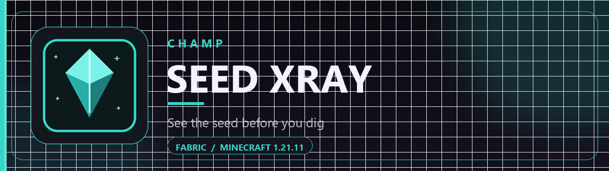
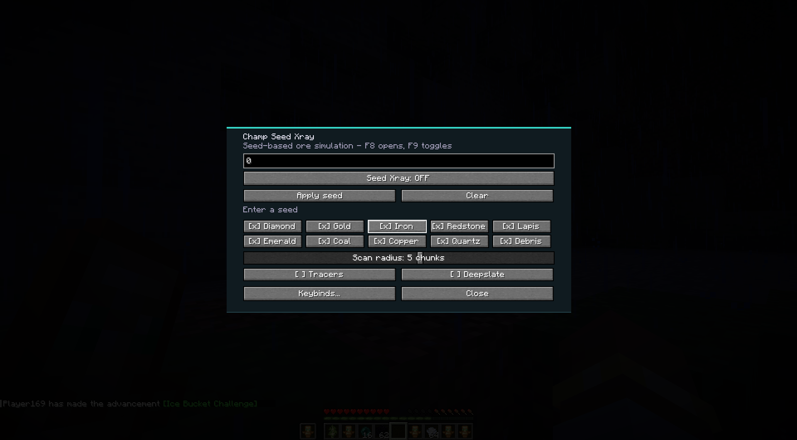

# Champ Seed Xray

A **client-side seed-based ore simulation** for **Minecraft 1.21.11** on **Fabric**, with a native Minecraft GUI.

Champ Seed Xray predicts vanilla ore positions from a world seed and shows them with coloured dust particles and optional tracers. It does not use an xray texture pack, it does not ask the server for hidden blocks, and it does not send your seed anywhere. The mod replays the vanilla ore placement steps locally using the client's loaded chunks and biome data.

There is no ImGui: the interface uses normal Minecraft buttons and sliders. The mod contains no API-key code, accounts, analytics, telemetry or network requests.

## Features

- Seed-based simulation for the overworld, Nether and End.
- Diamond, gold, iron, redstone, lapis, emerald, coal, copper, quartz and ancient debris.
- Toggle each ore group independently.
- Coloured dust particles at predicted positions.
- Optional tracer lines to nearby ores.
- Deepslate-only filter.
- Scan radius from 1 to 8 chunks.
- Optional Mod Menu 17.0.1 integration with a config button in the mod list.
- Built-in keybind editor with rebind and reset.
- Automatic cache reset when the dimension or seed changes.
- Settings saved in `config/champ-seed-xray.json`.
- Source code and a sources jar are included.

## How to use

1. Install Fabric Loader for Minecraft 1.21.11 and Fabric API.
2. Put `champ-seed-xray-1.1.0.jar` in your `mods` folder.
3. Optional: add Mod Menu 17.0.1 or newer to open the settings from the mod list.
4. Join a world and press `F8`.
4. Type the world seed. A plain number works, and a line such as `Seed: [123456789]` also works because the first integer is extracted.
5. Press `Apply seed`.
6. Press `Seed Xray: OFF` or press `F9` to start.
7. Choose the ores you want and set the scan radius.

Change the keys under `Keybinds...` in the panel, or in Minecraft's Controls screen. `Reset keys` restores F8 and F9.

The seed must be known. A multiplayer client cannot request the server seed, so this only works when you already know it and the world uses vanilla or near-vanilla ore generation.

## Options

| Option | Default | Description |
| --- | --- | --- |
| Seed | Empty | World seed used by the simulation. |
| Scan radius | 5 | Chunks around the player, from 1 to 8. |
| Tracers | Off | Draws lines toward nearby predicted ores. |
| Deepslate | Off | Shows only deepslate ore variants. |
| Ore buttons | All on | Toggles each ore group. |

A radius of 5 covers 121 chunks and may cost a moment on the first scan. Lower it to 3 or 4 if your client stutters. The status line shows the seed, dimension, cached chunk count and predicted ore count. The ancient debris button is labelled `Debris` so it fits the compact panel.

## How the prediction works

The mod finds vanilla ore features in the client's placed-feature registry, reads their count, height and rarity modifiers, then replays the population and decorator random steps for each chunk with the configured seed. It also checks the biome at each candidate position, so features that do not apply to that biome are skipped.

This is a prediction, not a block scan. Custom worldgen, datapacks, modded dimensions or server-side ore changes can make the result differ from the real world.

## Compatibility

| | |
| --- | --- |
| Minecraft | 1.21.11 |
| Loader | Fabric Loader 0.19.0+ |
| Dependency | Fabric API |
| Optional | Mod Menu 17.0.1+ |
| Java | 21 |
| Environment | Client |
| License | MIT |

## Important notes

- Use this only where server rules and local laws allow it.
- The seed must be known; the client cannot ask a server for it.
- Predictions assume vanilla ore generation. Modded or changed worldgen may not match.
- Particles and tracers are visual aids, not proof that a block exists.
- Large scan radii use more CPU and memory.

## Privacy and security

The mod contains no API-key handling, no tokens, no analytics and no outbound HTTP or WebSocket code. It does not upload your seed or world data. It writes only its local config file. The public GitHub repository has no collaborators and is read-only for visitors.

## License

MIT. See the repository's `LICENSE` file.
