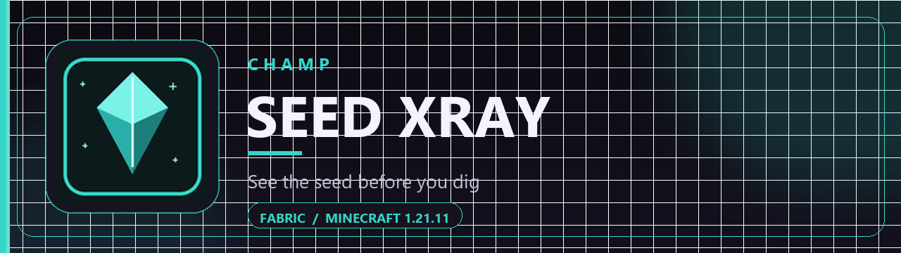
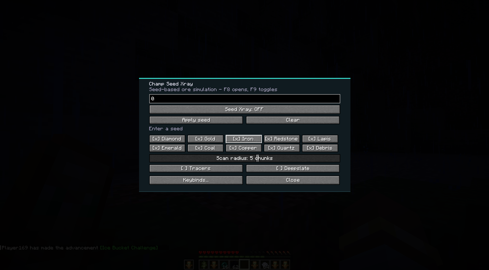
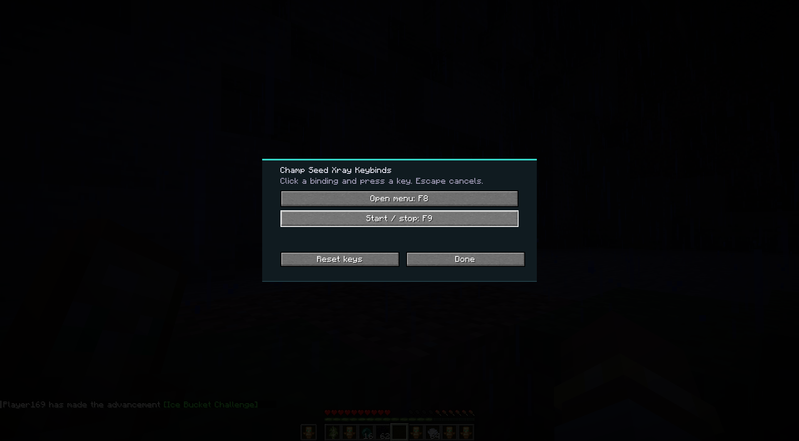

# Champ Seed Xray



A client-side seed-based ore simulation for **Minecraft 1.21.11** on **Fabric**, with a native Minecraft GUI.



Champ Seed Xray predicts where vanilla ore features generate for a given world seed and shows those positions with coloured dust particles and optional tracers. It reads the seed you type in, uses the client's loaded chunk and biome data, and simulates the vanilla ore placement steps locally. It does not ask a server for hidden blocks, does not use an xray texture pack and does not send the seed anywhere.

## Features

- Seed-based simulation of vanilla overworld, Nether and End ore placement.
- Ten ore groups: diamond, gold, iron, redstone, lapis, emerald, coal, copper, quartz and ancient debris.
- Per-ore visibility toggles.
- Coloured dust particles at predicted ore positions.
- Optional tracer lines to nearby predicted ores.
- Deepslate-only filter.
- Scan radius from 1 to 8 chunks.
- Automatic cache reset when the dimension or seed changes.
- Optional Mod Menu 17.0.1 integration; open the settings from the mod list.
- Built-in keybind editor with rebind and reset.
- Native Minecraft buttons and sliders, designed for GUI scale 2.
- Settings persist in `config/champ-seed-xray.json`.

## Requirements

| Requirement | Version |
| --- | --- |
| Minecraft | 1.21.11 |
| Fabric Loader | 0.19.0 or newer |
| Fabric API | 0.141.6+1.21.11 or newer for 1.21.11 |
| Java | 21 |
| Side | Client |

## Installation

1. Install Fabric Loader for Minecraft 1.21.11.
2. Put Fabric API in your `mods` folder.
3. Put `champ-seed-xray-1.1.0.jar` in the same `mods` folder.
4. Optional: install Mod Menu 17.0.1 or newer to open the settings from the mod list.
5. Start the game with the Fabric profile.

The sources jar is for reading and building, not for the `mods` folder.

## Controls

| Key | Action |
| --- | --- |
| `F8` | Open the Seed Xray panel |
| `F9` | Apply the seed and start or stop the simulation |
| `Escape` | Close the panel without stopping the simulation |

Change the keys in the panel under `Keybinds...`, or in Minecraft's normal Controls screen under the Champ Seed Xray category. `Reset keys` restores the F8 and F9 defaults.



## Usage

1. Join a world.
2. Press `F8`.
3. Type the world seed. A plain number works, and pasting a line such as `Seed: [123456789]` also works because the first integer is extracted.
4. Press `Apply seed`.
5. Press `Seed Xray: OFF` or press `F9` to start.
6. Choose which ores to show and adjust the scan radius.

The seed must be known. On a multiplayer server the client cannot ask the server for the seed; the feature only works when you already know it and the world uses vanilla or near-vanilla ore generation. Custom worldgen, datapacks, modded dimensions and server-side ore changes can make predictions differ from the real world.

## Options

| Option | Default | Description |
| --- | --- | --- |
| Seed | Empty | World seed used by the simulation. |
| Scan radius | 5 | Chunks around the player to simulate, from 1 to 8. |
| Tracers | Off | Draws lines toward nearby predicted ores. |
| Deepslate | Off | Shows only deepslate ore variants. |
| Ore buttons | All on | Toggle individual ore groups. |

A radius of 5 means 11 x 11 = 121 chunks and can take a moment on the first scan. Lower the radius if the client stutters. The status line shows the seed, dimension, cached chunk count and predicted ore count.

The button for ancient debris is shortened to `Debris` so it fits the compact panel; it still controls ancient debris.

## How the prediction works

The mod reads the placed-feature registry from the client's built-in registries, finds vanilla ore features and their placement modifiers, then replays the population and decorator random steps for each chunk with the configured seed. It also checks the biome at each candidate position so features that do not apply to that biome are skipped. Predicted positions are stored in a per-chunk cache.

This is a simulation, not a block scan. It cannot see blocks that the server has not sent to the client, and it cannot correct for non-vanilla generation.

## Configuration file

The mod writes:

```
.minecraft/config/champ-seed-xray.json
```

The file is plain JSON and stays on your computer. Deleting it restores the defaults.

## Important limits

- This is a client-side visualisation mod. Use it only where server rules and local laws allow it.
- The simulation assumes vanilla ore generation. Modded, custom or datapack worldgen may not match.
- A wrong seed, a changed world generator or a server that alters ore generation produces wrong predictions.
- Particles and tracers are rendering aids, not proof that a block is there.
- Large scan radii cost CPU and memory. Start at 3 to 5 chunks.

## Building from source

You need JDK 21. The Gradle wrapper is included.

```bash
./gradlew build
```

On Windows:

```bat
gradlew.bat build
```

The mod jar and sources jar are written to `build/libs/`:

```
champ-seed-xray-1.1.0.jar
champ-seed-xray-1.1.0-sources.jar
```

To run a development client:

```bash
./gradlew runClient
```

## Security and privacy

Champ Seed Xray contains no API-key code, no tokens, no analytics and no outbound HTTP or WebSocket requests. It does not upload the seed or any world data. The only file it writes is the local config file above. See [SECURITY.md](SECURITY.md).

The GitHub repository is public and has no collaborators, so visitors have read-only access to the upstream repository. Account security controls who can push. Forks are independent copies.

## License

MIT. See [LICENSE](LICENSE).

## Disclaimer

This project is not affiliated with Mojang, Microsoft, Fabric or any server. Minecraft is a trademark of Microsoft. Use the mod at your own risk and follow the rules of any server you join.
